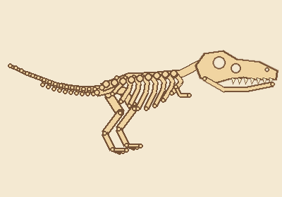

# Màn mẫu T‑Rex
Người chơi mở thùng rồi nhận ra hình và vị trí từng cụm xương qua silhouette. Mục tiêu thử nghiệm là người mới hiểu thao tác và hoàn thành lần đầu trong 60 giây. Mốc này chưa được đo. Trục tọa độ hướng phải và xuống, pivot ở tâm PNG, bàn 400 × 280. UI tiếng Việt, nền kem, nét nâu, xương vàng ngà, nút có chữ; nội dung cuộn theo chiều dọc, chiều rộng tối đa 600 logical pixel. Tranh giải phẫu hiện là hình cách điệu dùng thử cho việc nhận dạng mảnh.

| ID | Spec và tiêu chí chấp nhận | Plan và mã thực hiện | Review và bằng chứng |
|---|---|---|---|
| BOX-01 | Mỗi mảnh thuộc đúng một thùng. Mở lại không nhân bản mảnh | Nạp JSON, quan hệ mảnh → thùng, lọc khay từ opened/placed. model.dart, main.dart | Validator đạt với 4 mảnh, 2 thùng. Chờ QA-01 |
| SNAP-01 | Ghép đúng trong bán kính 30 đơn vị, khóa và báo rung/âm. Sai trả về khay. Zoom không đổi ngưỡng | Đổi global sang local qua RenderBox rồi chuẩn hóa theo board. So sánh khoảng cách và góc vòng tròn ở model. Render theo zIndex ở board.dart | Đã đối chiếu phép đổi tọa độ, điểm neo và đường ghi. Chờ model_test và QA-02 |
| HINT-01 | Mỗi lượt có 3 gợi ý. Mảnh chọn hoặc mảnh đầu khay sáng 3 giây. Hết lượt vẫn chơi được | Chỉ ghi giảm lượt khi có mảnh rời và còn gợi ý. Flame giảm thời gian sáng qua update | Đã đọc luồng nút bị vô hiệu và save. Chờ QA-03 |
| WIN-01 | Đủ bốn mảnh mở Victory; 0 / 1–2 / ≥3 gợi ý lần lượt đạt 3 / 2 / 1 sao | Cập nhật mảnh cuối, điểm cao nhất và 50 xu lần đầu trong một snapshot | Đã đối chiếu replay giữ best/coins. Chờ model_test và QA-04 |
| SAVE-01 | Khởi động lần đầu với ví 0. Sau mỗi lần mở thùng, xoay, ghép hoặc đổi tùy chọn, ghi snapshot; đọc lại khi mở app | Khóa ghi đồng thời; chỉ thay state UI sau khi ghi thành công. shared_preferences, khóa fossil.level1.v1 | Có test đọc/ghi mô hình và từ chối dữ liệu sai. Chờ QA-05 trên thiết bị |
| MUS-01 | Chưa hoàn thành hiện bảo tàng rỗng. Hoàn thành hiện T‑Rex với số sao tốt nhất | Gian trưng bày đọc best, dựng bộ xương bằng cùng PNG và tọa độ | Đã đối chiếu nguồn đọc với Victory. Chờ QA-04 |
| UI-01 | Home, bản đồ, mở thùng, bàn ghép, Victory, bảo tàng và cài đặt có đường vào/ra. Âm và rung tắt riêng | Duy trì màn đang xem trong session; quay lại map rồi tiếp tục. main.dart | Đã rà soát điều hướng trong code. Chờ QA-01, QA-06 |
| REL-01 | Build phân phối có obfuscation và symbols tách riêng | tool/release.sh, README | Đã kiểm tra cú pháp Bash. Chưa build release |

## Hợp đồng save v1
Một hồ sơ cục bộ cho màn 1. opened và placed là tập ID, angles lưu radian theo ID mảnh, used từ 0–3, best từ 0–3, coins nguyên không âm, sound và vibration mặc định true. Chỉ tương tác đã chấp nhận mới ghi. Replay xóa trạng thái lượt đang chơi và giữ ví, kỷ lục, cài đặt. Bảo tàng đọc cùng snapshot. Save phiên bản lạ hoặc dữ liệu lỗi đưa về màn thông báo và nút thử lại, giữ dữ liệu gốc. Chưa có giao diện khôi phục bản sao lưu. shared_preferences phù hợp prototype; kiểm tra khả năng phục hồi sau khi hệ điều hành dừng tiến trình trước khi chốt cơ chế lưu cho MVP.

## Kiểm tra đã thực hiện
Đã chạy python3 tool/validate.py trên JSON bàn giao, kiểm tra tọa độ góc bao, tham chiếu PNG trong suốt, ID và thùng, thông số ngưỡng, phần thưởng và WAV PCM. Đã chạy bash -n cho hai script. Ca Dart đã viết trong test/model_test.dart. Máy thực hiện không có flutter hoặc dart; phân tích tĩnh bằng SDK, build, test Dart, hình ảnh runtime, âm/rung, FPS và test thiết bị đều chờ chạy. Không có SDK quảng cáo hay analytics trong slice.

Hình được dựng trực tiếp từ dữ liệu màn để soát vị trí asset.

### TUT-01 · Buổi tập đầu tiên
Trước bản đồ, hồ sơ mới được thực hành mở thùng và kéo đuôi vào một ô đích. Thả ra ngoài trả xương về khay. Ghép đúng hoặc bỏ qua cho phép vào bản đồ. Ghi tutorialSeen vào save v1 khi người chơi chọn đi tiếp; quay về giữa bài cho phép tập lại từ đầu. Cài đặt có lối vào lại. Bài tập giữ trạng thái trong tutorial.dart, dùng asset thật và không gọi hàm cấp xu hoặc tăng lượt gợi ý. Đã bổ sung test/tutorial_test.dart cho luồng ghép và bỏ qua; chờ chạy Flutter.
